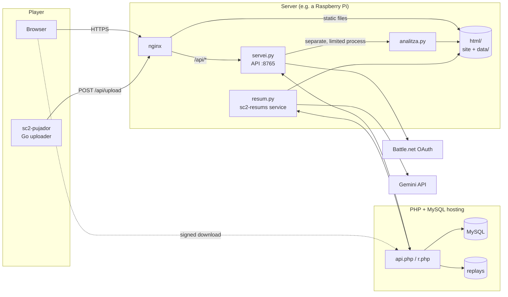

# sc2analisi — StarCraft II match analysis

**[sc2.lestudi.com](https://sc2.lestudi.com)** · licence **GPL-3.0-or-later** · website in 9 languages

A self-hosted website that analyses StarCraft II 1v1 replays in depth: who controls the map at every moment,
fights, bases, build orders, where each player's camera was, what every building is producing, per-player
statistics across all their games, an AI-written summary of each game, and even the game turned into music.

It runs on a small server (a Raspberry Pi is enough) plus ordinary PHP + MySQL shared hosting that stores the
replays and the database. No frameworks: Python with the standard library on the server, dependency-free JavaScript in the
browser, a small Go uploader and a few PHP files.

> The code comments and identifiers are in Catalan (the author's language); public names (files, URLs, API)
> are in English.

---

## Features

| | |
|---|---|
| **Animated map** | Each player's territory (influence model), structures, army, fights and base names, with a player (▶, ×8…×64, time slider, space bar to pause). |
| **Cameras** | A trapezoid in each player's colour shows where they were looking at every moment. |
| **Production clocks** | A clock on every building while it is being built or while it is producing a unit (×2 with a reactor). |
| **Fights and key moment** | Deaths grouped in space and time; whoever loses fewer resources wins; the fight with the biggest difference is the key moment. |
| **Bases and build order** | Who holds each base and when, and the first 60 things each player makes. |
| **Player profile** | MMR per race, win rate, map control at 8 min, expansion timings, APM/EPM, spending quotient, per matchup and per map. |
| **AI summary** | One paragraph written by Gemini from the game's numbers only (players are sent as "A" and "B"). |
| **Music** | The game plays as music along with the map (units = notes, fights = drums…) and can be downloaded as MIDI. |
| **Server list** | Every registered game, sortable by date, map, MMR and length, with filters. |
| **Uploading** | From the browser or with a small program that watches the replay folder (Windows and Linux). |
| **Battle.net** | OAuth login; uploaded games go to your profile. You can let others download your replays. |
| **Your own Gemini key** | Optional: your games are summarised with your own free quota. |

---

## Architecture



- **The site is static.** `genera.py` builds the pages from templates and texts; the data are JSON files written
  by the analyser (`html/data/…`), served directly by nginx.
- **The API (`servei.py`)** only does what cannot be static: receiving replays, login, sessions, download
  permissions, on-demand summaries and Gemini keys.
- **The PHP host (`cdn/`)** stores the replays (outside the web root) and the MySQL database, because the server
  may have a dynamic IP and shared hosts don't open MySQL to the outside. The server talks to it with a shared
  secret (`X-Clau` header).
- **Summaries** are made by a separate service (`sc2-resums`) little by little, because the free Gemini quota is small.

---

## Files

### Server (Python)

**`analitza.py`** — the core. Reads a replay with `s2protocol` and `mpyq` and extracts everything the site shows.
- `analitza(path, mapes)` walks the *tracker events* (births, deaths, positions, type changes, stats every 10 s,
  upgrades) and the *game events* (commands, selections, control groups and **camera**). Out come: players (race,
  result, MMR, APM, EPM), units with their paths, structures (started, finished, destroyed, and **what they
  produce**: the creator of every unit plus a build-time table, `TEMPS_FER`), economy, fights, bases and build order.
- **Fights:** groups nearby deaths in space and time; for each group, the army before and the losses of each
  player, the kind (skirmish, battle, worker raid, base kill…) and the place.
- **Bases:** `troba_bases()` clusters mineral and gas fields and `lloc_townhall()` finds where the town hall goes.
- **Map control:** `control_mapa()` is an influence model: every structure, creep tumour and army unit adds
  `w·exp(-d²/2σ²)` to nearby cells; a cell belongs to a player above a threshold and 1.5× the opponent's.
  **The same model is duplicated in `web/game.js`** (to draw it at any instant): change both together.
- **Maps:** `Mapes` downloads each map's `.s2ma` from Blizzard's depot, extracts the pathing grid and renders an
  image (`data/maps/<map>.png` + `.json`).
- **SQ (spending quotient):** `spending_quotient()`, `35·(0.00137·I − ln U) + 240`.
- **Indexes:** `data/players/<toon>.json` (each player's games, seen from their side) and `data/games.json`
  (every registered game, for the server list).
- Modes: `main` (re-analyses everything, downloading the replays from the PHP host to a temp dir), `una` (one uploaded
  replay: analyses it and, if the uploader played in it, adds it to their profile and the opponent's) and `reindexa`.

**`servei.py`** — the API behind nginx on `127.0.0.1:8765`, using the standard library's `http.server`.
- `POST /api/upload[?player=<toon>]` receives a replay (max. 8 MB), checks it is one and analyses it in a
  **separate process with limits** (60 s CPU, 1.5 GB RAM, one at a time: it may be a Raspberry Pi), then stores it on the PHP host.
- `GET /api/login` → Battle.net (OAuth, `state` in a cookie) → `GET /api/battlenet` creates the session. Sessions
  are stored in MySQL as the **sha256** of the cookie, with a 60 s cache.
- `GET /api/me`, `POST /api/logout`, `POST /api/share` (download permission).
- `GET /api/download?id=` checks whether the uploader allows it and redirects to a **signed link** on the PHP host
  (HMAC, 10 minutes): the file never goes through the server.
- `GET /api/summary?id=&lang=` returns the summary; if it doesn't exist in that language, it translates the English one there and then.
- `GET|POST /api/key` status, test and storage of the user's Gemini key (never returned).
- The old Catalan routes (`/api/envia`, `?jugador=`…) still work (`ALIES`): old uploaders use them.

**`magatzem.py`** — client for the PHP host's private API: replays (upload, download, list), users, sessions,
profiles, download permissions and **Gemini keys**, stored encrypted with AES-GCM. The encryption key only lives on
the server (`/etc/sc2/claus.key`) and the user id is authenticated data, so an encrypted key copied to another user
cannot be decrypted.

**`resum.py`** — the Gemini summaries.
- `fets(r)` reduces the game to numbers (bases, first orders, economy at 4/6/8/10/12/15/20 min, map control, the
  12 biggest fights) with the players as **A and B**: no names are sent to Google.
- The prompt asks for one paragraph using **only** that data. The text comes back with `{A}` and `{B}`, which the
  site replaces with the names linked to their profiles.
- Summaries are written in English; other languages are **translations of the English one**, keeping unit names in
  English (Gemini Lite invented the "official" names of the localised versions of the game).
- **Quotas:** the free tier (Flash 20 calls/day, Flash-Lite 500/day, renewed at midnight Pacific time). The
  background service uses Flash first (it writes better) and at most **400 Flash-Lite calls a day** (`LITE_SERVEI`),
  leaving the rest for translations requested by visitors. The counter is shared between processes through a file
  with `flock`.
- `treballa()` is the `sc2-resums` loop: first the games of users who added their own key (with their quota), then
  everything else **by MMR**. There is one summary per game: if both players have a key, whoever gets there first makes it.

**`genera.py`** — builds the site in `dist/`: copies `web/` and, for every page and language, fills
`plantilles/base.html` + `plantilles/<page>.html` with the texts in `textos.py` (Catalan at the root, the rest under
`/<code>/`). Adds `?v=<hash>` to every `.js` and `.css` so no browser uses a stale copy, and writes the site address
(`SC2_WEB`) into `install.sh` and the install command.

**`textos.py`** — every text on the site in 9 languages (Catalan + the 8 most spoken languages). `js.*` keys are for
JavaScript.

**`art.py`** — draws the background art for each race and for space, the icons and the favicon as SVG, from
original geometric shapes (no Blizzard artwork).

### Website (`web/`, dependency-free JavaScript)

- **`common.js`** — shared helpers: texts, formatting, colours, the **session** ("Sign in with Battle.net"), and a
  home-made **SVG line chart** with tooltip and a cursor that syncs with the map.
- **`index.js`** — the home page:
  - for **guests**, replay upload and the **server list** (sortable, filterable);
  - for a **profile** (`?player=<toon>`), the dashboard: race tabs (which switch the theme), MMR, map control at 8 min,
    expansion timings, APM, SQ, per matchup, per map and the list of games;
  - on **your** profile, the replay-sharing switch and your Gemini key.
- **`game.js`** — a game's page: the **map on a `<canvas>`** (control, structures with clocks, army, fights, bases,
  cameras), the player, the side panel, evolution charts, the fights table, bases, build order, the summary and the download.
- **`music.js`** — the music, with **Web Audio** and no libraries. Each player is an instrument by race (Terran
  square, Zerg sawtooth, Protoss pad), panned left and right. Every unit born is a note of a pentatonic scale (cheap
  units high, expensive ones low), bases are chords, fights are kick and snare, and a bass rises with the worker
  count — major when you lead in army, minor when you trail. Everything is quantised to eighth notes at 112 BPM. It
  also writes a **MIDI file** (format 0) of the whole game. Inspired by [sc2midi](https://github.com/obohrer/sc2midi).
- **`style.css`**, **`themes.css`** — styles and the four themes (Terran, Zerg, Protoss, space), light and dark.
- **`install.sh`** — `curl -fsSL https://sc2.lestudi.com/install.sh | sh` downloads the uploader for the machine's
  architecture and runs it.
- **`ads.js`** — only detects an ad blocker, to say it isn't needed here (there are no ads).

### PHP hosting (`cdn/`)

- **`api.php`** — private API (secret in the `X-Clau` header): stores replays (checking the id is the file's sha1),
  serves them, and bridges to MySQL for users, sessions, profiles, permissions and Gemini keys. Replays arrive as
  *multipart* because some shared hosts' ModSecurity blocks raw binary bodies.
- **`r.php`** — public download of a replay through a signed link (HMAC-SHA256 of `id|expiry|name`).
- **`.htaccess`** — no directory listing.

### Uploader (`pujador/`, Go)

A single dependency-free executable for Windows and Linux (x86_64 and ARM). When opened it **installs itself**
(`%LOCALAPPDATA%\SC2Analisi` + `Run` key on Windows; `~/.local/bin` + a systemd user unit on Linux), finds the
replay folders of every account, and from then on uploads each new game with the account's toon (`?player=`), so it
lands on that player's profile. It remembers what it uploaded, backs off on 429 and retries on errors.
`--uninstall` removes it; any other argument prints the help.

The server it uploads to is set **at build time** (`-ldflags "-X main.servidor=https://…/"`, done by `puja.sh` from
`SC2_WEB`) and can be overridden without rebuilding with the `SC2_WEB` environment variable.

**Installing it:**
- **Windows:** the `.exe` from the website.
- **Linux:** `curl -fsSL https://sc2.lestudi.com/install.sh | sh`
- **Arch Linux:** with the package in [`packaging/arch/`](packaging/arch/), which builds it from this repository:
  ```
  git clone https://github.com/EduardVidalTulsa/sc2analisi && cd sc2analisi/packaging/arch
  makepkg -si                                   # or: SC2_WEB=https://your-server makepkg -si
  systemctl --user enable --now sc2-pujador
  ```
  Installed this way (`-X main.empaquetat=si`) the binary doesn't copy itself to `~/.local/bin`: the user unit is
  already in `/usr/lib/systemd/user/`.

### Deployment

- **`puja.sh`** — builds the site, compiles the uploader and uploads everything (server, site, downloads and `cdn/`).
  `./puja.sh analitza` re-analyses every game. It reads its settings from **`puja.conf`** (not committed; copy
  [`puja.conf.example`](puja.conf.example)) or from the environment:

  | Variable | What it is |
  |---|---|
  | `SC2_WEB` | **public address of the site**: where the built uploader sends games, the address of `install.sh` and of the command shown on the home page, and the links between languages |
  | `SC2_SERVIDOR` | ssh target of the web/API server |
  | `SC2_DIR` | application directory on the server |
  | `SC2_CDN` | ssh target and web folder of the PHP host (`cdn/`) |
  | `SC2_TOON` | optional: the player whose games count as "mine" when re-analysing |

  On the server, `servei.py` also reads `SC2_WEB` (and `SC2_TOON`) from `/etc/sc2/web.env`, so the Battle.net
  login returns to `<SC2_WEB>/api/battlenet`.
- **`deploy/`** — example systemd services (`sc2-envia`, the API; `sc2-resums`, the summaries) with
  `ProtectSystem=strict` and only the directories they must write to, and an example nginx site (rate limit on uploads,
  redirects from the old Catalan names, `Cache-Control: no-cache` for CSS/JS).
- **`packaging/arch/`** — `PKGBUILD` for the uploader on Arch Linux.
- **`requirements.txt`** — `s2protocol`, `mpyq`, `numpy`, `pillow` and `cryptography`.

---

## Running your own instance

1. Python 3.12+ with a venv: `python -m venv .venv && .venv/bin/pip install -r requirements.txt`
   (`analitza.py` already shims the `imp` module that `s2protocol` still imports).
2. A `sc2` user, the directories `enviats/`, `maps/`, `html/` and `/var/lib/sc2`, and the secrets in `/etc/sc2/`
   (readable by the `sc2` group):
   - `battlenet.env`: `BNET_CLIENT_ID`, `BNET_CLIENT_SECRET` (an app at develop.battle.net with the redirect
     `https://<domain>/api/battlenet`);
   - `cdn.env`: `CDN_URL` (the `api.php`) and `CDN_CLAU` (the same secret as `~/.sc2/clau` on the PHP host);
   - `gemini.env`: `GEMINI_API_KEY` (optional; an AI Studio project **without billing** is free);
   - `claus.key`: 32 bytes in hex, to encrypt users' keys;
   - `web.env`: `SC2_WEB=https://<domain>` and optionally `SC2_TOON=<toon>`. To share the login with sister sites
     under the same domain, also `SC2_GALETA_DOMINI=<domain>` (the session cookie then covers every subdomain) and
     `SC2_ALTRES_WEBS=<host>,<host>` (hosts the login may return to with `/api/login?return=https://<host>/…`). `SC2_MA_UPLOAD=<url>` passes uploads
     that are not 1v1 to another service (Marine Arena), so the uploader can send those too.
3. On the PHP host: `api.php`, `r.php`, `.htaccess`, and in `~/.sc2/` the secret (`clau`) and the MySQL credentials
   (`my.cnf`). Call `api.php?op=installa` once to create the tables.
4. Copy and adapt `deploy/` (systemd and nginx).
5. Fill in `puja.conf` (from `puja.conf.example`) and deploy with `./puja.sh`. Put the same `SC2_WEB` (and
   optionally `SC2_TOON`, the player whose games count as "mine") in `/etc/sc2/web.env` on the server.

---

## Privacy

- Replays are stored outside the web root; a game can only be downloaded if its uploader allows it, through a link
  that expires.
- Games uploaded from the browser without a profile are never listed anywhere.
- Only numbers are sent to Gemini, with the players as A and B.
- Technical cookies only (session and login). No ads, no analytics.

## Licence

Copyright © 2026 Eduard Vidal i Tulsà.

This program is free software: you can redistribute it and/or modify it under the terms of the **GNU General Public
License** as published by the Free Software Foundation, either **version 3** of the License, or (at your option)
**any later version** (`GPL-3.0-or-later`). It is distributed WITHOUT ANY WARRANTY. See [`LICENSE`](LICENSE).

The fonts in `web/fonts/` (Rajdhani, Cinzel and Grenze) are from Google Fonts under the **SIL Open Font License 1.1**
(`web/fonts/llicencies/`). StarCraft is a trademark of Blizzard Entertainment; this project is not affiliated with it
and includes no game artwork.
